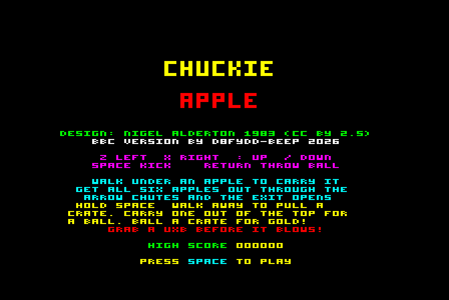
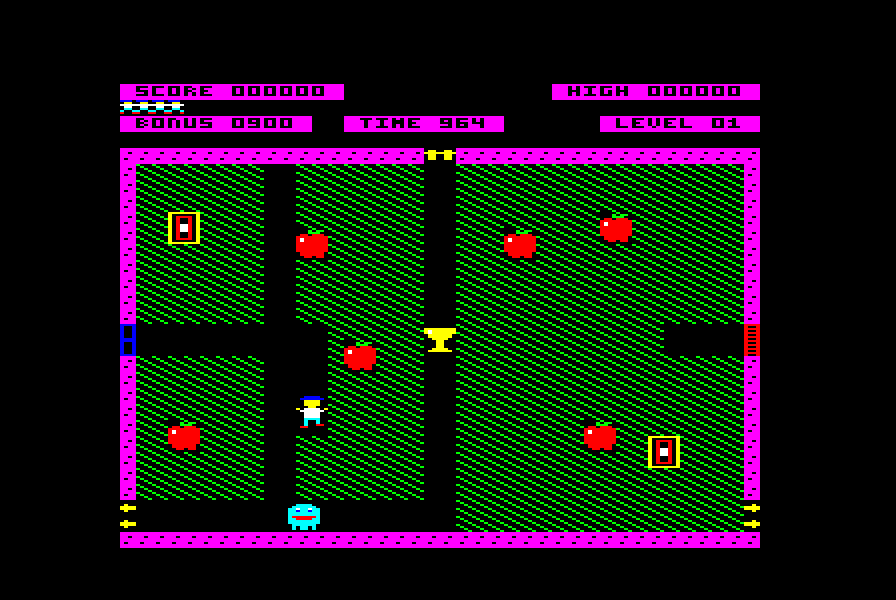

# Chuckie Apple

**The Chuckie Egg sequel that never was — a native BBC Micro game built from Nigel Alderton's original 1983 design notes.**

### [▶ Play it in your browser](https://bbc.godbolt.org/?disc=https://raw.githubusercontent.com/D8fydd-Beep/chuckie-apple/main/APPLE.ssd&autoboot)

 

## The story

After *Chuckie Egg* came out in 1983, Nigel Alderton started work on a follow-up — a Mr Do!-style digging game starring Hen House Harry, full of bouncing, falling, kickable apples. He left to join Ocean Software before it was finished, and the game was never made. His hand-drawn design notes were later published, with his permission, by [The Chuckie Egg Professional's Resource Kit](http://www.bagshot-row.org/chuckie-egg/) under a Creative Commons Attribution 2.5 licence.

This is that game, built for the machine it belongs on: 6502 machine code for the BBC Micro Model B, in MODE 2, with Nigel's own sketched level as level 1 and three more after it.

## Loading

| | |
|---|---|
| **Disc / MMFS / Gotek** | `APPLE.ssd` — SHIFT-BREAK to boot, or `*RUN APPLE` |
| **Tape** | `APPLE.uef` — `*TAPE` then `*RUN` (about 2¾ minutes) |
| **Emulators** | Use `APPLE.ssd` in BeebEm, b2 or jsbeeb. In BeebEm, set *Options → Keyboard Mapping → Default Mapping* so the `:` key works. |

Needs a standard 32K Model B. Press BREAK to leave.

## Keys

| Key | |
|---|---|
| `Z` / `X` | left / right |
| `:` / `/` | up / down |
| `SPACE` | kick an apple · grab a crate · pop an apple off your head |
| `RETURN` | throw a ball |

## How to play

Dig through the stuff and get all six apples off the screen through the three arrow chutes. Then the exit opens — walk out of it to finish the level.

- **Undermine an apple** and it falls — onto monsters, if you time it right. An apple landing on another apple smashes the lower one (and that counts).
- **Walk under an apple** and it rides on your head. Carry it up the middle shaft and out of the top chute. Tap SPACE to pop it up, then step away — it drops behind you onto whatever's chasing you.
- **Push apples** sideways (several at once is harder work), or **kick** them and they slide. Kick one that can't move and it explodes — it comes back as a ghost when you next walk through where it was.
- **Super bonus:** push all six out of a chute in one unbroken line for ten times the bonus, and four levels on.
- **Crates:** hold SPACE and walk away to pull one. Carry one out of the top chute to earn a **ball** (hold up to three); the crate turns up again somewhere else. A crate stuck on the bottom can be shoved out of a side chute.
- **The ball** bounces round the tunnels and kills the first monster it meets. Hit a crate with it and it becomes a **golden apple** — 1000 points out of any chute.
- **UXB apples** (orange) turn up with a 10-second fuse. Walk into one to defuse it — or it blows a crater in the stuff, and you with it if you're close.
- Anything pushed, lifted, dropped or kicked into a monster squashes it. Watch the TIME, and there's an extra life every 10,000 points.

## Source

`source/` has the full commented 6502 source for [BeebAsm](https://github.com/stardot/beebasm), and the Python script that draws the graphics and builds the levels. To rebuild everything:

```
python3 build.py path/to/beebasm
```

## Credits

- **Original design:** Nigel Alderton, 1983 — licensed [CC BY 2.5](https://creativecommons.org/licenses/by/2.5/)
- **BBC Micro version:** D8fydd-Beep, 2026
